<!-- Replace Sukithask everywhere with your GitHub Sukithask.
     Theme: Black 0B0D0A | Lime C6F35B | Olive 8CB82A | Text EDEDE6 -->

<!-- ============ HERO ============ -->

  

  

  
  
  
  

<!-- ============ 01 ABOUT ============ -->
## [ 01 ] About Me

<table>
<tr>
<td width="52%" valign="top">

I'm a **Mechatronics Engineering student at SNS College of Technology, Coimbatore**, building smart systems where **mechanical design, electronics, embedded control, robotics and IoT** meet.

I turn ideas into practical solutions for **assistive technology, healthcare, automation and sustainable energy**, and I love leading teams, public speaking and hosting events.

- 🦾 Building a **prosthetic arm** for assistive technology
- 🧑‍💼 **Team Manager** at B Touch Ind
- 📈 **CGPA 9.60** and **Academic Topper**
- 🗣️ **English · Tamil · Hindi · Japanese**

</td>
<td width="48%" align="center" valign="middle">

</td>
</tr>
</table>

<b>[ more about my journey ]</b>

 

My interests cover the whole product journey: understanding a problem, designing the mechanism, choosing components, writing control logic, building prototypes and improving them through testing and teamwork.

I'm also active in student communities as **Core Head of IETE Student Forum**, **Vice President of Tronexus (Mechatronics Engineering Association)** and **Executive Member of the Robotics Club** at SNSCT.

<!-- ============ 02 SKILLS ============ -->
## [ 02 ] Tech Arsenal

<table>
<tr>
<th width="34%" align="center">Design & Simulation</th>
<th width="33%" align="center">Programming & Tools</th>
<th width="33%" align="center">Domains</th>
</tr>
<tr>
<td valign="top" align="center">
 
 
 

</td>
<td valign="top" align="center">
 
 
 

</td>
<td valign="top" align="center">
 
 
 
 
 

</td>
</tr>
</table>

<!-- ============ 03 PROJECTS ============ -->
## [ 03 ] Featured Projects

<table>
<tr>
<td width="50%" valign="top">

### 🦾 BTC SPAR: 6-DOF Robotic Arm
Designed and built a six-degree-of-freedom arm integrating mechanical parts, motors and microcontroller-based control for precise movement.

  

</td>
<td width="50%" valign="top">

### 🖐️ Prosthetic Arm
A prosthetic arm system for assistive technology, combining mechanical design and control for functional movement.

  

</td>
</tr>
<tr>
<td width="50%" valign="top">

### ⚡ IoT Speed Breaker Energy Generation
An IoT-based speed breaker that generates energy from vehicle motion and monitors the output in real time.

  

</td>
<td width="50%" valign="top">

### 💧 IoT-Driven IV Liquid Monitoring
A low-cost system that monitors IV fluid levels in real time and alerts nurses instantly.

  

</td>
</tr>
</table>

<!-- Tip: add a real photo of a project by uploading it to assets/ and adding:
      -->

<!-- ============ 04 EXPERIENCE ============ -->
## [ 04 ] Experience

| Role | Company | Highlights |
|:---|:---|:---|
| **Team Manager** *(Present)* | B Touch Ind, Coimbatore | Prosthetic arm development for assistive technology; leading team coordination and project execution |
| **Intern** | Frank Technologies Pvt. Ltd., Coimbatore | Industrial processes in air compressor manufacturing |
| **Intern** | Lassol Private Limited, Coimbatore | Laser cutting and sheet metal fabrication |

<table>
<tr>
<td width="50%" valign="top">

### 🏆 Achievements
- 🥇 Winner, **Chemovate 2.0** Hackathon
- 🥇 Winner, **Odyssey 3.0** Hackathon
- 🎓 **Academic Topper**, 2024–2025 and 2025–2026
- 🎤 **Emcee** for 17+ events

</td>
<td width="50%" valign="top">

### 🤝 Leadership
- **Core Head**, IETE Student Forum, SNSCT
- **Vice President**, Mechatronics Engineering Association (Tronexus), SNSCT
- **Executive Member**, Robotics Club, SNSCT

</td>
</tr>
</table>

### 📜 Certifications

  
  
  
  

<!-- ============ 05 GITHUB ACTIVITY ============ -->
## [ 05 ] GitHub Activity

  
  

  

  

<!-- Snake: appears after you add .github/workflows/snake.yml and run it once -->

  

## [ 06 ] Let's Connect

I'm happy to connect with students, engineers, mentors and teams working in **robotics, IoT, embedded systems, assistive technology, mechanical design and industrial automation**.

  
  

<code>[ end of file · thanks for visiting ]</code>

