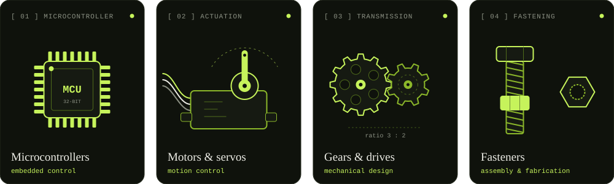

<!-- Username is set to Sukithask. Change it if your GitHub username is different.
     Theme: Black 0B0A10 | Purple A78BFA | Deep purple 7C5CE0 | Text EEEBF5 -->

<!-- ============ HERO ============ -->

  

  

  
  
  
  

<!-- ============ 01 ABOUT ============ -->
## [ 01 ] About Me

<table>
<tr>
<td width="48%" valign="top">

I'm a **Mechatronics Engineering student at SNS College of Technology, Coimbatore**, building smart systems where **mechanical design, electronics, embedded control, robotics and IoT** meet.

I turn ideas into practical solutions for **healthcare, automation and sustainable energy**, and I love public speaking and hosting events.

- 📈 **CGPA 9.60** and **Academic Topper**
- 🏆 Winner of **Chemovate 2.0** and **Odyssey 3.0** hackathons
- 🎤 **Emcee** for 17+ events
- 🗣️ **English · Tamil · Hindi · Japanese**

</td>
<td width="52%" align="center" valign="middle">

</td>
</tr>
</table>

<b>[ more about me ]</b>

 

I enjoy the whole journey from a problem to a working solution: understanding it, modelling it in CAD, simulating it, building it and improving it through testing and teamwork.

I'm active in student communities as **Core Head of IETE Student Forum**, **Vice President of Tronexus (Mechatronics Engineering Association)** and **Executive Member of the Robotics Club** at SNSCT.

<!-- floating keywords -->

  

<!-- ============ 02 TIMELINE ============ -->
## [ 02 ] My Journey

  

<!-- ============ 03 HARDWARE ============ -->
## [ 03 ] Hardware I Work With

  

<!-- ============ 04 CAD ============ -->
## [ 04 ] From Sketch to Drawing

  

<!-- ============ 05 SKILLS ============ -->
## [ 05 ] Tech Arsenal

<table>
<tr>
<th width="34%" align="center">Design & Simulation</th>
<th width="33%" align="center">Programming & Tools</th>
<th width="33%" align="center">Domains</th>
</tr>
<tr>
<td valign="top" align="center">
 
 
 

</td>
<td valign="top" align="center">
 
 
 

</td>
<td valign="top" align="center">
 
 
 
 
 

</td>
</tr>
</table>

  

<!-- ============ 06 PROJECTS ============ -->
## [ 06 ] Featured Projects

<table>
<tr>
<td width="50%" valign="top">

### ⚡ IoT Speed Breaker Energy Generation
An IoT-based speed breaker that generates energy from vehicle motion and monitors the output in real time.

  

</td>
<td width="50%" valign="top">

### 💧 IoT-Driven IV Liquid Monitoring
A low-cost system that monitors IV fluid levels in real time and alerts nurses instantly.

  

</td>
</tr>
</table>

Also built: a 6-DOF robotic arm and a prosthetic arm.

<!-- ============ 07 EXPERIENCE & ACHIEVEMENTS ============ -->
## [ 07 ] Experience

| Role | Company | Highlights |
|:---|:---|:---|
| **Intern** | Frank Technologies Pvt. Ltd., Coimbatore | Industrial processes in air compressor manufacturing |
| **Intern** | Lassol Private Limited, Coimbatore | Laser cutting and sheet metal fabrication |
| **Team Manager** | B Touch Ind, Coimbatore | |

### 🏆 Achievements

  

### 🤝 Leadership

- **Core Head**, IETE Student Forum, SNSCT
- **Vice President**, Mechatronics Engineering Association (Tronexus), SNSCT
- **Executive Member**, Robotics Club, SNSCT

### 📜 Certifications

  
  
  
  

<!-- ============ 08 GITHUB ACTIVITY ============ -->
## [ 08 ] GitHub Activity

  

<!-- Snake: appears after you add .github/workflows/snake.yml and run it once -->

  

## [ 09 ] Let's Connect

I'm happy to connect with students, engineers, mentors and teams working in **robotics, IoT, embedded systems, mechanical design, simulation and industrial automation**.

  
  

<code>[ end of file · thanks for visiting · ありがとう ]</code>

